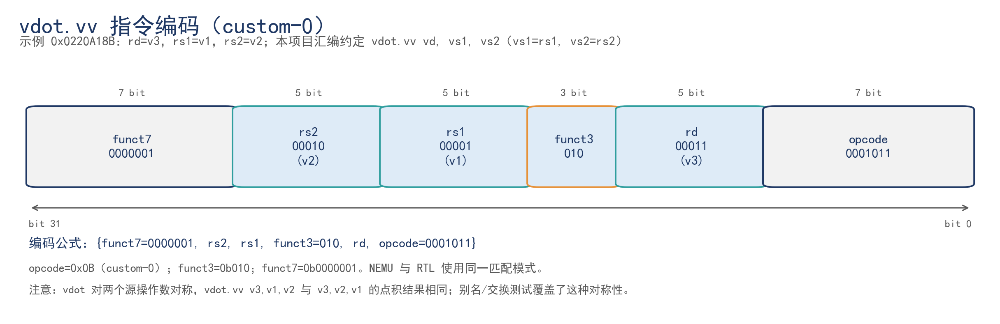
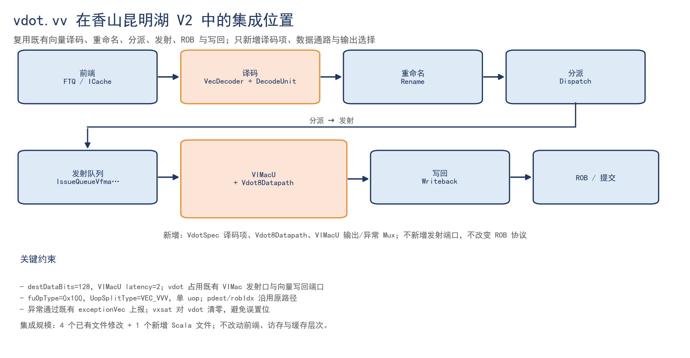
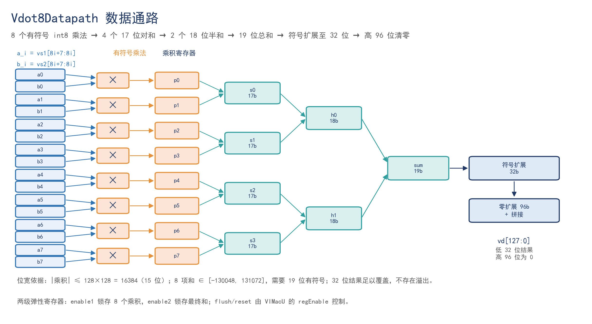

# vdot.vv：香山昆明湖 V2 的自定义向量点积指令

2026 CIE 全国 RISC-V 高水平创新及应用大赛 · 香山社区赛道参赛作品。

在香山（XiangShan）昆明湖 V2 的既有向量流水线上，以 **一条 custom-0 指令 + VIMacU 内部两级数据通路** 的方式实现 8 元素有符号 int8 点积；完成 RTL、NEMU 参考模型、逐指令协同仿真、正/负/边界测试、标准 RVV 基线与 1.53× 完整内核调用验证。

> 一句话：不是造一个新功能单元，而是在既有向量流水线里加一条可验证的点积旁路。

---

## 1. 关键结果

| 项目 | 结果 | 证据 |
|---|---|---|
| vdot 功能回归 | **841,260** instr / 790,553 cycles / IPC 1.064，HIT GOOD TRAP，a0=0（退出码 0），无 mismatch | [`results/t5b-clean-ref/vdot-a0.log`](results/t5b-clean-ref/vdot-a0.log)（历史 x0 版：[`evidence/logs/vdot-regression.log`](evidence/logs/vdot-regression.log)） |
| vadd 标准回归 | 23,876 instr / 16,870 cycles，HIT GOOD TRAP，a0=0 | [`results/t5b-clean-ref/vadd-a0.log`](results/t5b-clean-ref/vadd-a0.log) |
| VL=0 异常 | 274 instr / 2,865 cycles，3 traps，mtval=0，v3 保持，a0=0 | [`results/t5b-clean-ref/exception-check-a0.log`](results/t5b-clean-ref/exception-check-a0.log) |
| hello | `hello xiangshan, I am 工大喵喵队, IP address 192.168.124.133`，417 instr / 7,754 cycles，HIT GOOD TRAP（2026-11-06 用填好的 hello_identity.h 重跑） | [`results/kunminghu-v2-final/hello-team20261106.log`](results/kunminghu-v2-final/hello-team20261106.log)（旧日志另存为 `evidence/logs/hello-2026-10-31.log`） |
| 性能（先基线） | 7,881 → 5,141 cycles，**1.532970×**，−34.77% | [`evidence/logs/perf-baseline-first.log`](evidence/logs/perf-baseline-first.log) |
| 性能（先 vdot） | 7,882 → 5,119 cycles，**1.539754×**，−35.05% | [`evidence/logs/perf-custom-first.log`](evidence/logs/perf-custom-first.log) |
| RTL 单元测试 | **69,656** 向量 / 69,657 输出 / 4 取消事务，PASS | [`evidence/reports/unit-test-report.json`](evidence/reports/unit-test-report.json) |
| 设计文档 | 语义、编码、微架构、数据通路、异常、验证 | [`docs/03_第二阶段_vdot.vv设计文档.pdf`](docs/03_第二阶段_vdot.vv设计文档.pdf) |
| RTL 说明 | 4 改 1 增、关键代码、编译方法 | [`docs/04_第二阶段_RTL实现说明.pdf`](docs/04_第二阶段_RTL实现说明.pdf) |
| 提交说明 | 文件清单、提交位置 | [`docs/00_提交说明与文件清单.pdf`](docs/00_提交说明与文件清单.pdf) |

**口径说明**：1.53× 是 256 次完整内核调用的端到端延迟比，包含 `vsetvli`、两条 `vle8`、计算、`vse32`、函数调用/返回，不是单条 vdot 指令的固定 latency，也不是面积/频率/功耗收益。

---

## 2. 指令语义

`vdot.vv` 从两个向量寄存器各取 8 个有符号 int8 元素做点积，结果写入目的向量寄存器低 32 位，高 96 位清零：

```text
vd[31:0]   = Σ(i=0..7) sext8(vs1.byte[i]) × sext8(vs2.byte[i])
vd[127:32] = 0
```

合法配置：`VL=8`、`SEW=8`、`LMUL=1`、`vstart=0`、`vm=1`。其他配置抛非法指令异常（`mcause=2`），`mtval` 按发现阶段分两类：VL 类（执行阶段）为 `0`，SEW/LMUL/vstart 类（译码阶段）为指令字 `0x0220a18b`；标准非法指令为 `0x7b`。逐例实测见 [`results/t2-mtval-probe/mtval-probe.log`](results/t2-mtval-probe/mtval-probe.log)。

编码：custom-0，`funct7=0000001`、`funct3=010`、`opcode=0001011`；示例 `vdot.vv v3, v1, v2` → `0x0220A18B`。



> 本项目汇编约定 `vdot.vv vd, vs1, vs2`（`vs1=rs1`、`vs2=rs2`）。点积对两个源操作数对称；标准 RVV 的书写顺序是 `vd, vs2, vs1`，阅读编码字段时以本约定为准。

---

## 3. 微架构

vdot 复用香山既有向量译码、重命名、分派、发射、ROB、写回与异常通道，只在 VIMacU 内增加一条旁路数据通路。



| 阶段 | 修改 | 作用 |
|---|---|---|
| 译码 | `VecDecoder.scala` | custom-0 BitPat → `FuType.vimac`、`fuOp=0x100`、`VEC_VVV` |
| 译码合法性 | `DecodeUnit.scala` | `vtype.illegal`、`vsew≠0`、`vlmul≠0`、`vstart≠0` 提前报非法 |
| 译码分类 | `RiscvInst.scala` | 自定义 opcode 进入向量算术路径 |
| 执行 | `VIMacU.scala` | 实例化 `Vdot8Datapath`，输出/异常/vxsat Mux |
| 数据通路 | `Vdot8Datapath.scala` | 8 路有符号乘法 + 加法树 + 两级寄存器 |



位宽：乘积 16 位 → 对和 17 位 → 半和 18 位 → 总和 19 位 → 符号扩展 32 位 → `Cat(0^96, result)`。8×16,384=131,072，需要 19 位有符号；32 位结果不会溢出。

---

## 4. 目录结构

```text
.
├── README.md
├── LICENSE / NOTICE
├── docs/                     # 三阶段文档、复现/限制/证据说明、图
├── results/                  # a0/异常/性能/参数化证据（文档引用路径）
├── rtl/
│   ├── xiangshan/            # Vdot8Datapath.scala + 完整香山补丁
│   └── standalone/           # vdot8.sv 独立原型
├── nemu/                     # mtval 分阶段补丁、早期 validated/clean 补丁 + nemu.config
├── software/                 # 裸机测试程序：hello/vadd/vdot/exception/perf
├── tests/                    # testbench + Python 参考模型测试
├── tools/                    # 向量生成、波形提取、报告脚本
├── evidence/
│   ├── logs/                 # a0 回归、mtval probe、性能日志
│   ├── reports/              # 单元测试报告、波形证据、版本信息
│   ├── waves/                # FST / 精简 VCD / ELF / 反汇编
│   └── vectors/              # 69,656 个 oracle 向量
├── scripts/                  # 一键构建/回归/演示脚本
├── env/                      # 环境说明
└── submission/               # my_submission.txt 模板、PR 模板
```

---

## 5. 快速开始

### 5.1 环境

```bash
# Ubuntu 24.04 / x86_64，19 GiB RAM 以上
export JAVA_HOME=/opt/graalvm-jdk-21
export PATH=$JAVA_HOME/bin:/usr/local/llvm/bin:$PATH
export NOOP_HOME=$HOME/risv/xs-env/XiangShan
export NEMU_HOME=$HOME/risv/xs-env/NEMU
```

版本固定：

- XiangShan `16ae9ddcda54fc9a2fddffad73174cf793ac7814`
- NEMU `a48a11f208ff81ad765591d83271d1b339fb3861`
- `KunminghuV2MinimalConfig`
- boot flash 16 B，SHA256 `fea548655a8b6eecacace83e2f4380a18b8aa83bce964c8aae4cffbe2f5a9724`

### 5.2 应用补丁

```bash
cd $NOOP_HOME
git apply /path/to/rtl/xiangshan/xiangshan-vdot-complete.patch

cd $NEMU_HOME
git apply /path/to/nemu/nemu-tval.patch
```

> `nemu-tval.patch` 是 mtval 分阶段修复：SEW/LMUL/vstart 在译码阶段保留指令字，VL 类在执行阶段置 0。`nemu-vdot-validated.patch` / `nemu-vdot-clean.patch` 是早期版本，不含这个修复，不能拿它们证明 8 种非法配置的 mtval 对齐。

### 5.3 构建

```bash
cd $NEMU_HOME
make riscv64-xs-ref_defconfig
make -j$(nproc)

cd $NOOP_HOME
make emu CONFIG=KunminghuV2MinimalConfig JVM_XMX=12G EMU_THREADS=2 -j2
```

### 5.4 编译软件

```bash
cd software
make all hello vadd exception-check perf perf-reverse vdot-wave
```

### 5.5 跑回归

```bash
cd $NOOP_HOME
for t in vdot vadd exception-check hello; do
  ./build/emu -i $HOME/risv/project/software/build/$t.bin \
    --diff $NEMU_HOME/build/riscv64-nemu-interpreter-so \
    -F $HOME/risv/artifacts/boot-minimal.bin
done
```

### 5.6 本机 RTL 单元测试

```bash
python3 tools/run_tests.py
# 期望：PASS vectors=69656 checked=69657 cancelled=4 cycles=108440
```

需要 Icarus Verilog 14.0；如果使用仓库内 `tools/oss-cad-suite`，把 OSS CAD Suite 解压到该目录即可（仓库不包含 600 MB 工具包）。

---

## 6. 证据地图

| 你想证明 | 看这个 |
|---|---|
| 环境/版本可复现 | `docs/01_第一阶段_环境部署与hello验证.pdf`、`evidence/reports/version-info.txt` |
| hello 真实输出 | `evidence/logs/hello.log` 第 11 行 |
| vadd 波形真实 | `evidence/waves/vadd-stage1.fst`、`evidence/reports/vadd-wave-evidence.json` |
| vdot 功能正确 | `evidence/logs/vdot-regression.log` 第 23436 行 |
| 正/负/边界 | `docs/05_第二阶段_正数负数边界测试报告.pdf`、`evidence/vectors/vectors.json` |
| 异常/恢复 | `evidence/logs/exception-regression.log`、`software/exception_check.S` |
| NEMU/RTL 一致 | `docs/06_第三阶段_NEMU扩展与协同仿真.pdf` |
| 1.53× | `evidence/logs/perf-*.log`、`docs/07_第三阶段_基线与延迟加速分析.pdf` |
| vdot 两级数据通路 | `evidence/waves/vdot-single.fst`、`evidence/reports/vdot-wave-evidence.json` |

完整 SHA256 清单：`evidence/manifest.json`。详细复现：`docs/REPRODUCE.md`；限制：`docs/LIMITATIONS.md`。

---

## 7. 已知限制

- 只支持 `VL=8`、`SEW=8`、`LMUL=1`、`vstart=0`、`vm=1`；其他配置未做整机异常覆盖。
- 异常覆盖 M 模式 8 种非法配置：VL 类 `mtval=0`，SEW/LMUL/vstart 类 `mtval=0x0220a18b`，标准非法 `0x7b`；S/VS 委托、RNMI、NMIE=0 早退路径未覆盖。
- NEMU 的 A/B 只覆盖 SEW=16 和 VL=0；LMUL=2、vstart=1 的 mtval 由 probe 逐例测量，还没有带 difftest 的 A/B。
- 波形来自 `MinimalConfig`；性能来自 `KunminghuV2MinimalConfig`，两个配置的数字不能混。
- 1.53× 是完整内核调用，不是单条指令 latency；12× 是计算路径观测区间，不是整机加速。
- 参数化只到独立模块级（n=4/8/16），未整核集成；没有综合/STA，所以没有面积、频率、功耗、时序数据。
- 69,656 向量验证的是独立 `vdot8.sv` 原型；整机验证的是 Scala 集成版，二者结构一致但不是同一份代码。

---

## 8. 许可

本仓库自有代码与文档采用 **Apache License 2.0**。香山（XiangShan）、NEMU 及其子模块遵循其各自许可证；本仓库的补丁只包含为赛题新增/修改的片段，应用后仍受上游许可证约束。详见 `LICENSE` 与 `NOTICE`。

---

## 9. 参赛信息

- 团队：`工大喵喵队`（易丁琪、任锦林、张煊熙）
- 赛题：面向边缘 AI 大语言模型推理的 RISC-V 自定义 vdot 指令设计——基于“香山”昆明湖 V2 处理器架构
- 赛事：2026 CIE 全国 RISC-V 高水平创新及应用大赛 · 香山社区赛道
- 代码仓库：`https://github.com/mapler2191/cie2026-vdot-team-xiangshan-vdot`
- 提交说明：`submission/SUBMIT_GUIDE.md`

